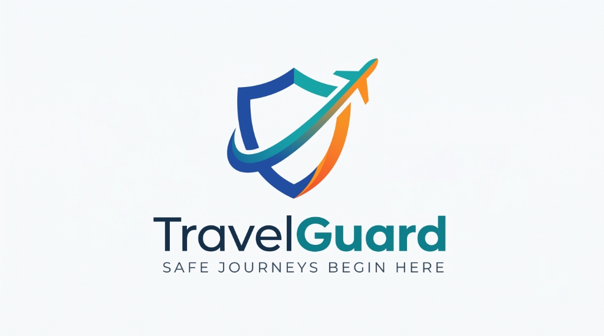

# TravelGuard 🛡️✈️

**Safe Journeys Begin Here**

AI-powered travel safety assistant for first-time emigrants and travelers from Kerala & India going to the Gulf (UAE, Saudi Arabia, Qatar, Oman, Bahrain, Kuwait).



---

## 🌟 What TravelGuard Does

TravelGuard solves critical pre-departure and transit anxieties for first-time Gulf emigrants through a luxury frosted-glass interface that runs smoothly on smartphones and desktop computers alike.

1. **🛡️ Offer Check (`POST /api/offer-check`)**
   - Detects fraudulent job recruitment letters, visa scams, and unauthorized agents.
   - Accepts pasted text OR photos/screenshots analyzed by Gemini Vision.
   - Grounded in official MEA & eMigrate rules.

2. **📜 Work Contract Reader (`POST /api/contract-check`)**
   - Photographs or text of employment contracts analyzed for legal compliance.
   - Flags illegal passport retention under UAE Federal Decree Law No. 33 of 2021.
   - Validates working hours (8 hrs/day max) and prohibits visa fee deductions.

3. **🧳 Pack Check (`POST /api/pack-check`)**
   - Verifies medicines, foods, and valuables against UAE Customs regulations.
   - Distinguishes allowed OTC drugs (Paracetamol) from strictly banned substances (Codeine).
   - Accurately enforces the official UAE cash declaration limit (**AED 60,000**).

4. **🎒 Handbag Cabin Checklist (`GET /api/handbag`)**
   - Must-have documents, cash, prescriptions, and smart cabin suggestions.
   - Strictly enforces the aviation lithium battery rule (power banks in handbag ONLY, never check-in).
   - Persistent tick-boxes saved in `localStorage` with a live **"Packed %"** progress bar.

5. **💱 Currency Converter (`GET /api/currency`)**
   - Real-time exchange rate with cached file fallback (`data/currency_cache.json`).
   - Quick converter for AED, INR, SAR, QAR, USD, OMR, KWD.
   - Multilingual pro tip advising against high airport counter exchange fees.

6. **✈️ Airport Boarding Guide (`POST /api/boarding-guide`)**
   - Step-by-step milestone timeline (arrive-by, check-in, PoE for ECR passports, security, immigration, boarding gate).
   - Live "What to do right now" status banner based on current time.

7. **📱 UAE Airport SIM Guide (`POST /api/sim-guide`)**
   - Matches tourist and resident profiles to verified e& (Etisalat), du, and Virgin Mobile plans.
   - Details the complimentary 1GB Tourist SIM provided at Dubai & Abu Dhabi immigration.
   - Strictly grounded in curated data (`data/sim_plans.json`) with no AI price hallucinations.

8. **🚨 Expatriate Emergency Card (`GET /api/emergency-card`)**
   - Tap-to-call direct dialers for NORKA-Roots, Indian Embassy Abu Dhabi, CGI Dubai, MEA eMigrate, UAE Police (999), Ambulance (998), and MOHRE (800-60).

9. **📋 Journey Checklist (`POST /api/checklist`)**
   - Personalized dated checklist by travel purpose (Work / Visit / Layover).
   - Airport layover exit safety and return-by-time calculation.

---

## 🌐 Trilingual Support & Read-Aloud

- Full instant toggle across **English**, **Malayalam (മലയാളം)**, and **Hindi (हिन्दी)**.
- Web Speech Synthesis API voice readout (`en-IN`, `ml-IN`, `hi-IN`) with tap-to-listen and stop controls.
- Official disclaimer on every assessment with direct links to `emigate.gov.in`, `norkaroots.org`, and `mohap.gov.ae`.

---

## 🎨 UI & Design Architecture

- **Fluid Responsiveness**:
  - **Mobile**: Apple iOS Dynamic Island "water notch" floating header, frosted glass cards, and floating dock.
  - **Desktop ($\ge 768px$ & $\ge 1080px$)**: Full-width executive dashboard with header navigation bar and responsive grid cards.
- **Custom Swatch Palette**:
  - Sky Blue: `#99CDD8`
  - Mint: `#DAEBE3`
  - Cream: `#FDE8D3`
  - Coral: `#F3C3B2`
  - Sage: `#CFD6C4`
  - Slate Green: `#657166`

---

## 🛠️ Tech Stack

- **Backend**: Python 3.11+ / FastAPI / Uvicorn
- **AI & Multimodal Vision**: Google Gemini API (`gemini-3.8-flash`) with robust rule-based fallback handlers
- **Frontend**: Mobile-first & desktop responsive vanilla HTML5, CSS3 Glassmorphism, JavaScript ES6
- **Testing**: Pytest (42 comprehensive test cases across all features)

---

## 🚀 Quick Start

### 1. Install Dependencies
```bash
pip install -r requirements.txt
```

### 2. Set Gemini API Key
```bash
# Windows (Command Prompt)
set GEMINI_API_KEY=your_gemini_api_key

# Windows (PowerShell)
$env:GEMINI_API_KEY="your_gemini_api_key"

# Linux / macOS
export GEMINI_API_KEY="your_gemini_api_key"
```

### 3. Run Locally
```bash
python main.py
```
Open **`http://127.0.0.1:8000`** in your browser.

---

## 🧪 Running Automated Tests

Run the complete test suite (42 tests):
```bash
pytest -v
```

---

## 🐳 Docker & Cloud Deployment

### Run with Docker
```bash
docker build -t travelguard .
docker run -p 8000:8000 -e GEMINI_API_KEY=your_key travelguard
```

### Deploy to Render
1. Connect repository on [Render](https://render.com).
2. Create a **Web Service**.
3. Build command: `pip install -r requirements.txt`
4. Start command: `uvicorn main:app --host 0.0.0.0 --port $PORT`
5. Set environment variable: `GEMINI_API_KEY`.

### Deploy to Railway
1. Connect repository on [Railway](https://railway.app).
2. Add environment variable: `GEMINI_API_KEY`.
3. Railway automatically detects the included `Dockerfile` and deploys.

---

## 🎯 Stage Demo Mode
Click the **"🎯 Stage Demo Mode"** button on the home screen to instantly pre-fill:
- A high-risk scam offer asking for upfront fees.
- An illegal contract demanding passport custody and unpaid 12-hour shifts.
- A pack check list containing banned cough syrup with codeine alongside permitted paracetamol.
